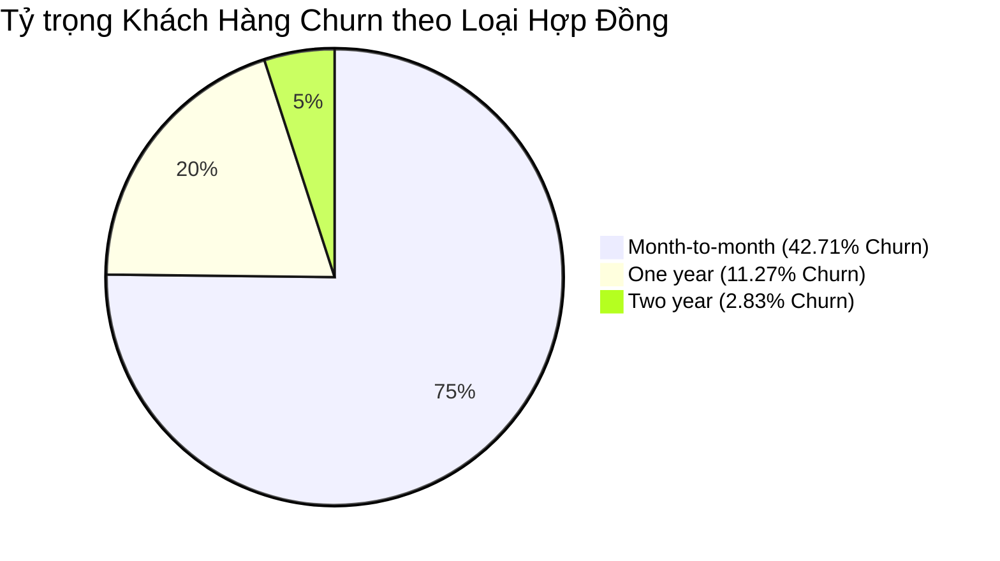
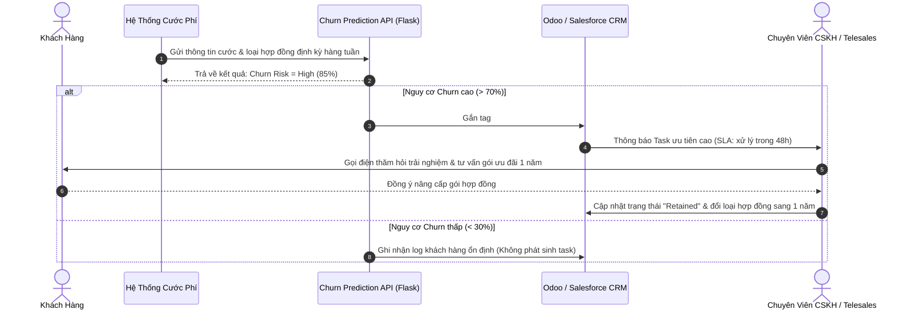

# BÁO CÁO PHÂN TÍCH KINH DOANH (BUSINESS CASE STUDY)
## Chiến Lược Giảm Thiểu Tỷ Lệ Rời Bỏ Khách Hàng (Customer Churn Retention Strategy)
**Dự án:** Telco Customer Churn Prediction & Retention Analytics  
**Tác giả:** Business Analyst / Data Analyst: Võ Thanh Hải  
**Bộ phận thụ hưởng:** Customer Success (CS), Marketing & Telesales Retention Team  

---

### 1. TỔNG QUAN VÀ BỐI CẢNH KINH DOANH (EXECUTIVE SUMMARY)

* **Bối cảnh:** Trong ngành dịch vụ viễn thông và thuê bao định kỳ (Subscription/Telco), chi phí thu hút khách hàng mới (Customer Acquisition Cost - CAC) thường **cao gấp 5 đến 7 lần** chi phí giữ chân khách hàng cũ (Customer Retention Cost - CRC).
* **Quy mô thiệt hại thực tế từ dữ liệu (7,043 khách hàng):**
  * Tỷ lệ khách hàng rời bỏ (Churn Rate): **26.54%** (1,869 khách hàng rời dịch vụ).
  * Doanh thu hàng tháng bị bốc hơi (Monthly Lost Revenue): **$139,130 USD / tháng**.
  * Thiệt hại doanh thu quy năm (Annualized Lost ARR): **~$1.67 Triệu USD / năm**.
* **Mục tiêu phân tích (Business Objective):** 
  * Xác định các nguyên nhân gốc rễ (Root Causes) khiến khách hàng rời mạng.
  * Ứng dụng mô hình học máy (Logistic Regression kết hợp kỹ thuật cân bằng dữ liệu SMOTE) để gắn nhãn nguy cơ rời bỏ sớm.
  * Thiết kế bài toán Chi phí - Lợi ích (Cost-Benefit Matrix) và đề xuất chiến dịch giữ chân khách hàng (Retention Campaign) với tỷ suất sinh lời **ROI > 6x**.

---

### 2. PHÂN TÍCH CÁC NHÂN TỐ GÂY RỜI BỎ (ROOT CAUSE ANALYSIS)

Dựa trên dữ liệu phân tích định lượng, 3 yếu tố cốt lõi chi phối quyết định rời mạng của khách hàng gồm:

#### 2.1. Loại Hợp Đồng (Contract Type) - Rào cản gắn kết lỏng lẻo
* Khách hàng dùng gói **Month-to-month (thanh toán từng tháng)** có tỷ lệ churn lên tới **42.71%**, chiếm đại đa số lượng khách hàng rời bỏ.
* Trong khi đó, khách hàng ký hợp đồng **1 năm chỉ churn 11.27%**, và hợp đồng **2 năm chỉ churn 2.83%**.
* 👉 **Hành động:** Chuyển đổi khách hàng từ gói từng tháng sang hợp đồng kỳ hạn 1–2 năm là chìa khóa then chốt để dập tắt 80% rủi ro rời bỏ.

#### 2.2. Phương Thức Thanh Toán (Payment Method) - Trải nghiệm thanh toán ma sát
* Nhóm thanh toán bằng **Electronic Check (Séc điện tử)** có tỷ lệ rời bỏ bất thường: **45.29%** (cao gấp 3 lần so với thanh toán tự động qua Thẻ tín dụng 15.2% hoặc Chuyển khoản ngân hàng 16.7%).
* 👉 **Insight:** Thanh toán thủ công mỗi tháng tạo ra điểm chạm nhắc nhở về chi phí ("Pain of paying"), khiến khách hàng dễ hủy dịch vụ hơn so với cơ chế Auto-debit (thanh toán tự động định kỳ).

#### 2.3. Dịch Vụ Giá Trị Gia Tăng (Tech Support & Online Security)
* Khách hàng **không đăng ký Hỗ trợ kỹ thuật (No Tech Support)** có tỷ lệ churn **41.64%**, cao gần gấp 3 lần nhóm có sử dụng Tech Support (**15.17%**).
* Khi gặp sự cố mạng cáp quang (Fiber Optic) mà không được hỗ trợ kịp thời, khách hàng lập tức chuyển sang đối thủ cạnh tranh.

---

### 3. BÀI TOÁN CHI PHÍ - LỢI ÍCH & TỶ SUẤT ROI (COST-BENEFIT ANALYSIS)

Mô hình Machine Learning (Logistic Regression + SMOTE) giúp sàng lọc chính xác các khách hàng nằm trong vùng nguy cơ cao để tung chiến dịch ưu đãi có mục tiêu (thay vì giảm giá dàn trải gây lãng phí ngân sách).

#### Giả lập Chiến dịch Giữ chân Khách hàng (Retention Campaign):
* **Tệp mục tiêu:** 1,000 khách hàng nguy cơ cao (đang dùng gói Month-to-month, cước trung bình \$75/tháng).
* **Gói giải pháp can thiệp (Incentive Offer):**
  * Tặng ưu đãi giảm **\$10/tháng trong vòng 6 tháng** nếu chuyển đổi sang hợp đồng cam kết 1 năm.
  * Tặng miễn phí dịch vụ **Tech Support cao cấp trong 6 tháng đầu**.
* **Ước tính hiệu quả can thiệp (Chuyển đổi thành công 30% = 300 khách hàng):**

| Hạng mục chi phí / Lợi ích | Công thức tính | Số tiền (USD) |
| :--- | :--- | :---: |
| **Doanh thu giữ lại được trong năm (Preserved ARR)** | 300 khách × ($75 - $10) × 12 tháng | **+$234,000** |
| **Chi phí ngân sách ưu đãi (Cost of Discounts)** | 300 khách × $10 × 6 tháng | **-$18,000** |
| **Chi phí vận hành telesales / CSKH** | $15 / khách được liên hệ × 1,000 khách | **-$15,000** |
| **Lợi nhuận ròng thu về (Net Revenue Saved)** | $234,000 - $18,000 - $15,000 | **+$201,000** |
| **Tỷ suất sinh lời ROI (Return on Investment)** | $201,000 / ($18,000 + $15,000) | **609% (ROI ~ 6.1x)** |

> 📌 **Kết luận tài chính:** Với mỗi 1 USD chi ra cho chiến dịch giữ chân khách hàng mục tiêu, doanh nghiệp thu hồi lại **$6.1 USD** doanh thu thuần không bị mất vào tay đối thủ.

---

### 4. QUY TRÌNH NGHIỆP VỤ TÍCH HỢP HỆ THỐNG CRM (BPMN OPERATIONAL WORKFLOW)

Để mô hình không chỉ nằm trên giấy, hệ thống được thiết kế để tích hợp trực tiếp vào quy trình làm việc của đội ngũ CSKH/Telesales (ví dụ trên hệ thống **Odoo CRM / Salesforce**):

---

### 5. LỘ TRÌNH ĐO LƯỜNG VÀ CHỈ SỐ THEO DÕI (KPIS)
1. **Net Churn Rate:** Giảm tỷ lệ rời mạng chung từ 26.5% xuống dưới **20%** trong vòng 6 tháng đầu triển khai.
2. **Contract Migration Rate:** Tăng tỷ lệ khách hàng chuyển từ Month-to-month sang One/Two year contract thêm **25%**.
3. **Retention Contact Rate:** 100% khách hàng có điểm rủi ro cao (High Risk) được chuyên viên CSKH liên hệ trước 10 ngày so với chu kỳ gia hạn hợp đồng tiếp theo.
