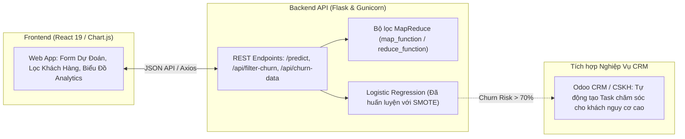

# 🚀 Hệ Thống Dự Đoán Khách Hàng Rời Bỏ Dịch Vụ (Customer Churn Prediction System)
### *End-to-End Retention Analytics, MapReduce Paradigm Simulation & Machine Learning Deployment*

[](https://customer-prediction-big-data-sfsa.vercel.app)
[](https://customer-prediction-bigdata.onrender.com)
[](https://python.org)
[](https://flask.palletsprojects.com)
[](https://reactjs.org)
[](https://scikit-learn.org)
[](LICENSE)

Hệ thống dự đoán hành vi rời bỏ dịch vụ viễn thông (Customer Churn Prediction) toàn diện từ dữ liệu thô (7,043 hồ sơ), giải quyết bài toán mất cân bằng lớp (Class Imbalance) bằng kỹ thuật **SMOTE**, xử lý dữ liệu theo mô hình **MapReduce paradigm**, và triển khai ứng dụng thực tế đa nền tảng (**React + Flask** trên **Vercel & Render**).

📄 **Đọc toàn bộ tài liệu nghiên cứu nghiệp vụ tại:** [BÁO CÁO BUSINESS CASE CHURN RETENTION](BUSINESS_CASE.md)

---

## 🌟 Điểm Nổi Bật Của Dự Án

* **Giá trị kinh doanh thực chiến (Business Value):** Phân tích chỉ ra tỷ lệ churn là **26.54%**, gây thất thoát **~$1.67 Triệu USD/năm**. Mô hình xây dựng chiến dịch giữ chân khách hàng (Retention Campaign) mục tiêu với tỷ suất sinh lời **ROI ~ 6.1x**.
* **Giải quyết mất cân bằng dữ liệu (Class Imbalance):** Thử nghiệm và đánh giá so sánh nhiều kỹ thuật lấy mẫu: `Mô hình cơ bản`, `SMOTE`, `SMOTETomek`, `ADASYN`, `RandomUnderSampler` để tối ưu Recall và F1-Score cho nhóm khách hàng Churn.
* **Mô phỏng mô hình MapReduce:** Hiện thực hóa các hàm `map_function` và `reduce_function` để lọc dữ liệu lớn, tổng hợp biểu đồ thống kê cước phí và tìm kiếm khách hàng hiệu quả.
* **Full-stack & Cloud Deployment:** 
  * Frontend: Xây dựng bằng React 19, Chart.js, triển khai trên **Vercel**.
  * Backend: RESTful API với Flask, Gunicorn, CORS hỗ trợ kết nối an toàn, triển khai trên **Render**.

---

## 🏗️ Kiến Trúc Hệ Thống (Architecture Flowchart)



---

## 📊 Tóm Tắt Nguyên Nhân Gây Churn Hàng Đầu (Key Insights)

| Yếu Tố Phân Tích | Nhóm Nguy Cơ Cao | Tỷ Lệ Churn | So Sánh Với Nhóm An Toàn | Đề Xuất Nghiệp Vụ |
| :--- | :--- | :---: | :--- | :--- |
| **Loại hợp đồng** | Month-to-month | **42.71%** | Cao gấp 15 lần nhóm hợp đồng 2 năm (2.83%) | Tặng ưu đãi giảm $10/tháng để chuyển sang gói 1 năm |
| **Phương thức thanh toán** | Electronic check | **45.29%** | Cao gấp 3 lần nhóm Credit Card tự động (15.24%) | Khuyến khích đăng ký thanh toán tự động (Auto-debit) |
| **Hỗ trợ kỹ thuật** | No Tech Support | **41.64%** | Nhóm có Tech Support chỉ churn 15.17% | Miễn phí 6 tháng dịch vụ Tech Support cho gói mạng mới |

---

## 📁 Cấu Trúc Dự Án (Repository Structure)

```text
Customer-Prediction-BigData/
│
├── app.py                          # Flask RESTful API server
├── wsgi.py                         # WSGI entrypoint cho Gunicorn trên Render
├── requirements.txt                # Thư viện phụ thuộc Python
├── render.yaml                     # Cấu hình tự động triển khai Render
├── .env.example                    # File mẫu biến môi trường (an toàn)
├── codethucthi.ipynb               # Notebook huấn luyện, SMOTE & đánh giá mô hình
├── BUSINESS_CASE.md                # Báo cáo chuyên sâu Business Analyst & ROI
├── README.md                       # Tài liệu hướng dẫn dự án
│
├── best_logistic_model.pkl         # Mô hình Logistic Regression tốt nhất
├── scaler.pkl                      # Bộ chuẩn hóa dữ liệu StandardScaler
│
├── dulieutrain.csv                 # Dữ liệu phục vụ huấn luyện
├── thongke.csv                     # Dữ liệu thống kê churn theo loại hợp đồng
├── WA_Fn-UseC_-Telco-Customer-Churn.csv # Dataset gốc Telco Churn (7,043 dòng)
├── xemfulldata.csv                 # Dữ liệu khách hàng phục vụ chức năng tìm kiếm
│
├── react-frontend/                 # Ứng dụng giao diện người dùng React 19
│   ├── src/components/             # Các component: PredictionForm, ChartPage, FilterPage...
│   ├── public/                     # Static assets
│   └── package.json                # Dependencies React, Chart.js, Axios
│
├── docs/                           # Tài liệu triển khai & hướng dẫn chi tiết
│   ├── DEPLOY_GUIDE.md             # Hướng dẫn chi tiết triển khai Render & Vercel
│   └── QUICK_DEPLOY.md             # Hướng dẫn deploy nhanh
│
├── rapidminer/                     # Các file quy trình phân tích RapidMiner (.rmp)
│   ├── thongke.rmp
│   ├── train.rmp
│   └── xemfull.rmp
│
└── scripts/                        # Các script hỗ trợ triển khai và kiểm thử
    ├── start.bat / start.sh        # Khởi động đồng thời cả Backend và Frontend
    └── test-backend.bat            # Kiểm tra sức khỏe API
```

---

## 🚀 Hướng Dẫn Cài Đặt & Chạy Cục Bộ (Local Setup)

### 1. Khởi động Backend (Flask)
```bash
# Cài đặt thư viện Python
pip install -r requirements.txt

# Khởi chạy Flask server (chạy tại http://localhost:5000)
python app.py
```

### 2. Khởi động Frontend (React)
```bash
# Di chuyển vào thư mục frontend
cd react-frontend

# Cài đặt thư viện Node.js
npm install

# Khởi chạy ứng dụng (chạy tại http://localhost:3000 hoặc 3001)
npm start
```

---

## 🌐 Các Endpoint API Chính

* `GET /health`: Kiểm tra trạng thái hoạt động của máy chủ.
* `POST /predict`: Dự đoán nguy cơ rời bỏ của khách hàng.
  ```json
  {
    "MonthlyCharges": 75.5,
    "Contract": "Month-to-month"
  }
  ```
* `GET /api/filter-churn?churn=Yes`: Lấy danh sách khách hàng theo trạng thái rời bỏ.
* `GET /api/churn-data`: Lấy số liệu phân tích tổng hợp phục vụ hiển thị biểu đồ.
* `GET /api/search-customers`: Tìm kiếm khách hàng theo các bộ lọc đa tiêu chí.

---

## 🤝 Tác Giả & Liên Hệ
* **Tác giả:** Võ Thanh Hải ([@ThanhHaiOwen](https://github.com/ThanhHaiOwen))
* **Email:** vothanhhai156@gmail.com
